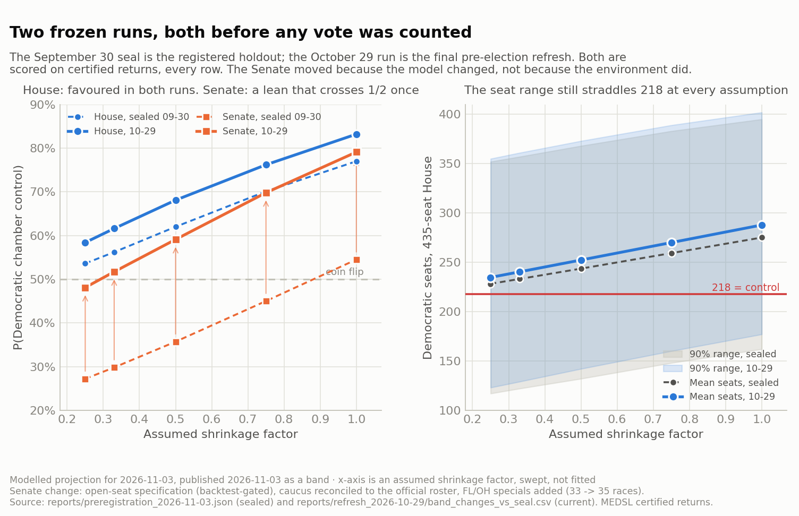
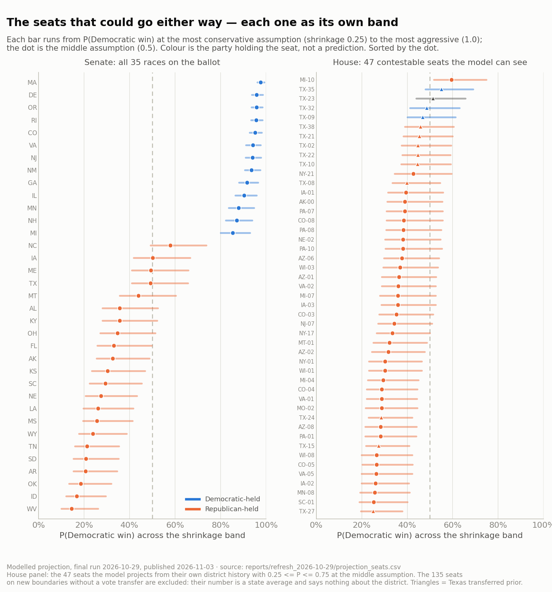

# What the Model Says, and How I Will Grade It

*Polls close tonight. Here is the prediction, frozen on October 29, and the rules I wrote in September for scoring it, which I am no longer allowed to change.*

**Savepoint Analytics · US Election Analysis · modelled projection, published as a band · final run 2026-10-29 · published 2026-11-03**

---

## The short version

My model says Democrats are favoured to win the House under every assumption I am willing to make about the national environment, and that the Senate leans Democratic but crosses the coin flip at the most conservative of those assumptions. It says both of those things with wide intervals, and I am publishing the intervals, not a headline.

[Five weeks ago I wrote that I would not publish this](05-the-forecast-i-am-not-publishing.md). Two of the three reasons have since been fixed, the third I have decided to accept, and the postscript on that post explains the reversal. What follows is the prediction itself, in the form it has to take if it is going to be graded rather than believed.

## Why there are five rows and not one

The model's view of the national environment comes from eight special elections held between April 2025 and June 2026, in which Democratic candidates beat their district's 2024 presidential baseline by an average of 21.2 points of margin. Special electorates are not general electorates.  They are smaller, more engaged and occur wherever a vacancy happened, so some fraction of that overperformance carries into November. The fraction is called **shrinkage**. One cycle of specials cannot identify it, and [the four historical cycles I checked span too wide a range to narrow it](03-the-parameter-that-wasnt-there.md). So the model does not estimate shrinkage. It **sweeps** it. A sweep is a modelling term that amounts to "try every answer": I don't know how much of that 21 points carries into November, so instead of guessing, I ran the model five times — assuming a quarter of it carries, a third, half, three-quarters, or potentially all of it. Every row below is one of those runs.

That is the whole table. Reading one row and ignoring the others is the thing the design exists to prevent.

| Shrinkage | Implied national Dem share | House mean seats | House 90% range | P(Dem House) | Senate Dem seats (of 100) | P(Dem Senate) |
|---:|---:|---:|---|---:|---:|---:|
| 0.25 | 0.524 | 234.7 | 123–355 | 0.584 | 51.1 | 0.481 |
| 0.33 | 0.532 | 240.3 | 129–361 | 0.616 | 51.7 | 0.517 |
| 0.50 | 0.550 | 252.3 | 142–373 | 0.681 | 53.0 | 0.591 |
| 0.75 | 0.577 | 270.0 | 160–389 | 0.762 | 55.0 | 0.698 |
| 1.00 | 0.603 | 287.8 | 177–402 | 0.832 | 56.9 | 0.791 |

*Final pre-election run, 2026-10-29. Source: `reports/refresh_2026-10-29/`. The 2024 House national input (contested races, total-vote weighted) is 0.497; each row adds a shrinkage multiple of the specials swing to it.*

**The House.** Democrats are favoured at every row. The 90% seat range straddles 218 at every row too.  The lowest row of the sweep allows for a Republican House of 123 Democratic seats and the high end for a Democratic House of 402, which is what it costs to admit that 135 of 435 seats are projected from their state's partisan lean rather than their own history (more on that to follow).

**The Senate.** Four rows above one half, one at 0.481. Mean Democratic seats run from 51 to 57, with 34 Democratic holdovers not on the ballot and 35 races up. The control probability sits well below where the mean seat count would put it under independence, because the simulation shares error across races: if the environment is a point worse than the row assumes, it is worse in Iowa and Texas at the same time. I would describe this as a lean, not a call. The seats the model has closest to even at the middle assumption are North Carolina (0.58), Iowa (0.50), Texas (0.49), Maine (0.49) and Montana (0.44). They look close because they are close.

## The model, written down

For readers who want the specification rather than the prose. Everything here is in the repository; nothing is simplified for the page.

**National environment.** The 2024 House two-party Democratic share (contested races, vote-weighted) is N₂₀₂₄ = 0.4974. Eight special elections give a mean margin overperformance against their districts' 2024 presidential baselines of Δ = 0.2119 (s.e. 0.024). For each assumed carry-over s ∈ {0.25, 0.33, 0.5, 0.75, 1.0}:

> N(s) = N₂₀₂₄ + s · Δ / 2

Δ is a margin; halving converts it to a share. s is not estimated but rather a swept assumption, and everything below is conditioned on one row of N(s).

**House seats.** Ordinary least squares on certified returns 1976–2024, contested races only, with the lag grouped by the plan that actually governed the district so a mid-decade redraw breaks it where the territory changed:

> yᵢ = α + β₁·leanᵢ + β₂·N(s) + β₃·IncDᵢ + β₄·IncRᵢ + εᵢ,  εᵢ ~ (0, σ_H)

yᵢ is the district's two-party Democratic share; leanᵢ is its previous share minus the previous national share, so no information from the cycle being predicted enters the predictor; IncD and IncR are indicators for a Democratic or Republican incumbent on the ballot. Fitted residual σ_H = 0.112.

**Senate races.** The `v1_open_seat_holder` specification, promoted on 2026-10-29 by a chronological backtest over 661 held-out races (MAE 0.0645 → 0.0638, 90% coverage 0.935 → 0.944):

> yⱼ = α + β₁·pres_leanⱼ + β₂·IncDⱼ + β₃·IncRⱼ + β₄·midtermⱼ + β₅·OpenDⱼ + β₆·OpenRⱼ + εⱼ,  σ_S = 0.125

pres_lean is the state's 2024 presidential share minus the national one; midterm is ±1 against the president's party in a midterm year; OpenD and OpenR mark seats whose holder is not running, so a departing incumbent's advantage is not credited to the seat they are leaving.

**Seats the model cannot see.** For the 135 redrawn seats without a vote transfer, the mean is the state's presidential lean plus the incumbency term, and the uncertainty is widened in quadrature by how much the model leans on the lean coefficient:

> σ_fallback = √(σ_H² + (β₁ · sd_lean)²) = √(0.112² + (β₁ · 0.172)²) = 0.146

For Texas's 38 transferred seats the same formula uses the transfer's measured backtest error (0.122) in place of sd_lean. Both inputs are measured; neither is a factor chosen by hand.

**Simulation.** 10,000 draws. Each seat's error is σᵢ times a standard normal assembled from three shared pieces:

> eᵢ = √0.45 · z_nat + √0.25 · z_region(i) + √0.30 · zᵢ

so a miss in one state moves demographically similar states with it. The 45/25/30 split is asserted, not estimated from residuals (declared below). A seat's win probability is the share of draws with yᵢ > 0.5; chamber control is the share of draws with at least 218 Democratic seats in the House or 51 in the Senate. This is why the Senate's mean seat count can be 53 at the middle assumption while P(control) is only 0.59: the shared national component makes the seat total far more dispersed than independent coin flips would.

**Evaluation.** Forward-only chronological folds (i.e. all data used in the model reflects cycles before t to predict the outcome in t) scored on mean absolute error of share, Brier and log score on win probability, calibration over ten bins, and 90%/95% interval coverage, against naive persistence (each seat repeats its previous share). House: MAE 0.065 vs 0.080, 90% coverage 0.913. Senate: 0.064 vs 0.084, coverage 0.944. 

The fitted coefficients are not printed here because they are not in any published artefact yet; when the post-mortem is written they will be, with standard errors, alongside the scores.

## Seat by seat

A chamber probability is the sum of a lot of seat probabilities, and the honest way to show it is seat by seat with the whole band. Three tiers, because the model knows different amounts about different seats.

**The Senate: every race is model-informed.** Fifteen of the 35 are inside 0.25–0.75 at the middle assumption; the other twenty sit above 0.75 (MI, NH, MN, IL, GA, NM, NJ, VA, CO, RI, OR, DE, MA) or below 0.25 (WV, ID, OK, AR, SD, TN, WY). Colour in the figure is the party that holds the seat. "Candidacy" says whether the sitting member's status on the ballot was verified from an official source or assumed.

| State | Held by | Candidacy | P(D) @0.25 | P(D) @0.5 | P(D) @1.0 | Mean D share @0.5 |
|---|---:|---:|---:|---:|---:|---:|
| MS | Rep | assumed | 0.19 | 0.26 | 0.41 | 0.419 |
| LA | Rep | assumed | 0.20 | 0.26 | 0.42 | 0.421 |
| NE | Rep | verified | 0.21 | 0.27 | 0.43 | 0.425 |
| SC | Rep | assumed | 0.22 | 0.29 | 0.45 | 0.432 |
| KS | Rep | assumed | 0.23 | 0.30 | 0.47 | 0.437 |
| AK | Rep | assumed | 0.25 | 0.33 | 0.49 | 0.444 |
| FL | Rep | verified | 0.26 | 0.33 | 0.50 | 0.445 |
| OH | Rep | verified | 0.27 | 0.35 | 0.51 | 0.450 |
| KY | Rep | verified | 0.28 | 0.36 | 0.52 | 0.453 |
| AL | Rep | verified | 0.28 | 0.36 | 0.52 | 0.454 |
| MT | Rep | verified | 0.36 | 0.44 | 0.60 | 0.481 |
| TX | Rep | verified | 0.41 | 0.49 | 0.66 | 0.499 |
| ME | Rep | assumed | 0.41 | 0.49 | 0.66 | 0.499 |
| IA | Rep | verified | 0.42 | 0.50 | 0.67 | 0.500 |
| NC | Rep | verified | 0.49 | 0.58 | 0.74 | 0.527 |

**The House of Representatives' 47 contestable seats the model can see.** These are projected from their own district history (or, for Texas, from a measured precinct-level transfer of 2024 results onto the 2026 map) and sit inside 0.25–0.75 at the middle assumption. Of the 300 seats in this tier, the favoured party differs from the current holder in 4 seats at the middle assumption (MI-10, TX-23, TX-32, TX-09) and 24 at the top of the band.

| Seat | Held by | Prior | P(D) @0.25 | P(D) @0.5 | P(D) @1.0 | Mean D share @0.5 |
|---|---:|---:|---:|---:|---:|---:|
| TX-27 | Rep | transfer | 0.20 | 0.25 | 0.38 | 0.413 |
| SC-01 | Rep | own history | 0.19 | 0.25 | 0.40 | 0.426 |
| MN-08 | Rep | own history | 0.19 | 0.26 | 0.41 | 0.427 |
| IA-02 | Rep | own history | 0.20 | 0.26 | 0.41 | 0.428 |
| VA-05 | Rep | own history | 0.20 | 0.26 | 0.42 | 0.430 |
| CO-05 | Rep | own history | 0.20 | 0.26 | 0.42 | 0.432 |
| WI-08 | Rep | own history | 0.20 | 0.27 | 0.42 | 0.431 |
| TX-15 | Rep | transfer | 0.22 | 0.28 | 0.41 | 0.422 |
| PA-01 | Rep | own history | 0.22 | 0.28 | 0.44 | 0.436 |
| AZ-08 | Rep | own history | 0.22 | 0.28 | 0.44 | 0.436 |
| TX-24 | Rep | transfer | 0.23 | 0.29 | 0.42 | 0.427 |
| MO-02 | Rep | own history | 0.22 | 0.29 | 0.44 | 0.438 |
| VA-01 | Rep | own history | 0.22 | 0.29 | 0.44 | 0.436 |
| CO-04 | Rep | own history | 0.22 | 0.29 | 0.44 | 0.438 |
| MI-04 | Rep | own history | 0.23 | 0.29 | 0.45 | 0.439 |
| WI-01 | Rep | own history | 0.23 | 0.30 | 0.46 | 0.443 |
| NY-01 | Rep | own history | 0.23 | 0.30 | 0.46 | 0.443 |
| AZ-02 | Rep | own history | 0.25 | 0.32 | 0.48 | 0.447 |
| MT-01 | Rep | own history | 0.25 | 0.32 | 0.49 | 0.450 |
| NY-17 | Rep | own history | 0.26 | 0.33 | 0.50 | 0.454 |
| NJ-07 | Rep | own history | 0.27 | 0.34 | 0.51 | 0.456 |
| CO-03 | Rep | own history | 0.28 | 0.35 | 0.51 | 0.457 |
| IA-03 | Rep | own history | 0.29 | 0.36 | 0.52 | 0.461 |
| MI-07 | Rep | own history | 0.28 | 0.36 | 0.52 | 0.461 |
| VA-02 | Rep | own history | 0.29 | 0.36 | 0.52 | 0.460 |
| AZ-01 | Rep | own history | 0.29 | 0.36 | 0.53 | 0.461 |
| WI-03 | Rep | own history | 0.29 | 0.37 | 0.53 | 0.464 |
| AZ-06 | Rep | own history | 0.30 | 0.38 | 0.54 | 0.464 |
| PA-10 | Rep | own history | 0.30 | 0.38 | 0.55 | 0.468 |
| NE-02 | Rep | own history | 0.30 | 0.38 | 0.55 | 0.466 |
| PA-08 | Rep | own history | 0.31 | 0.38 | 0.55 | 0.467 |
| CO-08 | Rep | own history | 0.31 | 0.38 | 0.56 | 0.469 |
| PA-07 | Rep | own history | 0.31 | 0.39 | 0.56 | 0.468 |
| AK-00 | Rep | own history | 0.31 | 0.39 | 0.55 | 0.468 |
| IA-01 | Rep | own history | 0.32 | 0.39 | 0.56 | 0.470 |
| TX-08 | Rep | transfer | 0.33 | 0.40 | 0.54 | 0.469 |
| NY-21 | Rep | own history | 0.34 | 0.43 | 0.59 | 0.480 |
| TX-10 | Rep | transfer | 0.37 | 0.45 | 0.59 | 0.483 |
| TX-22 | Rep | transfer | 0.38 | 0.45 | 0.59 | 0.483 |
| TX-02 | Rep | transfer | 0.38 | 0.45 | 0.59 | 0.482 |
| TX-21 | Rep | transfer | 0.38 | 0.45 | 0.60 | 0.485 |
| TX-38 | Rep | transfer | 0.39 | 0.46 | 0.60 | 0.487 |
| TX-09 | Dem | transfer | 0.40 | 0.47 | 0.61 | 0.490 |
| TX-32 | Dem | transfer | 0.41 | 0.49 | 0.63 | 0.496 |
| TX-23 | Other | transfer | 0.44 | 0.51 | 0.66 | 0.504 |
| TX-35 | Dem | transfer | 0.48 | 0.55 | 0.69 | 0.516 |
| MI-10 | Rep | own history | 0.52 | 0.59 | 0.75 | 0.527 |

Two things to notice, and neither is a storyline. First, the list is almost entirely Republican-held: every row of the band assumes a Democratic-leaning environment, so Democratic-held seats only enter when their territory changed (i.e. the three Texas seats). The model has no race-level inputs (no polls, no candidate quality, no fundraising in the baseline), so a Democratic seat that is vulnerable for local reasons is invisible to it; that is a declared limitation, below. Second, the Texas transferred seats carry sigma 0.122 against the modelled 0.112, so their bands are a little wider by construction.

**The House of Representatives' 135 seats the model cannot see.** The remaining redrawn seats have no transferred prior. Each takes its state's 2024 presidential lean plus an incumbency term, so every Republican-held seat in a state gets roughly the same number, and every Democratic-held seat another. Listing those per district would dress a state average up as a district forecast, so they are shown by state. Where a range appears, it comes from the incumbency term (open seats and verified candidacies), not from anything the model knows about the district. Note what that construction cannot see: a seat whose new territory favours the other party. The incumbency term credits the holder as if the lines had not moved, so a seat that changes hands because of a redraw is, by construction, one this tier will have called wrong. Texas shows what that hides. It is the one redrawn state with a vote transfer, and the transfer puts three Democratic-held seats at or below even.  These are seats a state-lean fallback would have scored as comfortably Democratic.

| State | Fallback seats | Held D / R / other | Rep-held seats, P(D) @0.25 / 0.5 / 1.0 | Dem-held seats, P(D) @0.25 / 0.5 / 1.0 |
|---|---:|---:|---:|---:|
| AL | 7 | 2 / 5 / 0 | 0.18 / 0.22 / 0.33 | 0.57 / 0.63 / 0.74 |
| CA | 52 | 43 / 8 / 1 | 0.51–0.87 / 0.58–0.90 / 0.70–0.95 | 0.71–0.87 / 0.76–0.90 / 0.85–0.95 |
| FL | 28 | 7 / 20 / 1 | 0.27–0.47 / 0.33–0.53 / 0.46–0.66 | 0.46–0.69 / 0.53–0.75 / 0.65–0.84 |
| LA | 6 | 2 / 4 / 0 | 0.22 / 0.27 / 0.39 | 0.63 / 0.69 / 0.79 |
| NC | 14 | 4 / 10 / 0 | 0.34–0.54 / 0.40–0.60 / 0.53–0.72 | 0.75 / 0.80 / 0.88 |
| OH | 15 | 5 / 10 / 0 | 0.29 / 0.34 / 0.47 | 0.70 / 0.75 / 0.84 |
| TN | 9 | 1 / 8 / 0 | 0.18 / 0.22 / 0.33 | 0.57 / 0.64 / 0.75 |
| UT | 4 | 0 / 4 / 0 | 0.22 / 0.27 / 0.39 | — |

A per-seat CSV of the Senate races and the 47 House seats is at `blog/exports/contestable_seats_2026-10-29.csv`. A district map is deliberately absent: the 2026 boundaries for eight of the nine redrawn states are not yet in the project's geography layer, and a map drawn on last cycle's shapes would be the exact error [post 6](06-the-map-is-not-the-territory-and-neither-is-the-number.md) is about.

## What was sealed in September, and why October is different

The dashed lines in the figure are a second prediction, sealed on September 30 and hashed (`4de09ecf…`), which my scoring code treats as the registered holdout. It will be graded alongside the October run, by the same rules, on the same certified returns. I am showing both so that a reader can see which direction the model moved in the five weeks between them and decide for themselves whether that was drift or improvement.

The House moved modestly: +6 to +13 mean seats across the sweep. About 4.6 seats of that at every row came from restoring New York's 26 districts, which an over-strict validator had quarantined ([F-2 and F-3 in the findings](../../reports/preregistration_2026-11-03_findings.md)); the rest from a refreshed specials baseline that raised the measured swing from 18.8 to 21.2 points of margin.

The Senate moved a lot; from 0.27–0.55 to 0.48–0.79.  It is important to note that none of that came from new evidence about the national environment. It came from three changes to the model, each recorded with its gate:

1. **An open-seat term.** The September specification credited every seat with its incumbent's advantage, including seats the incumbent is leaving. A specification that treats an open seat as held by its party but without the personal incumbency term was promoted by a chronological backtest across 661 held-out Senate races (MAE 0.0645 → 0.0638, open-seat MAE 0.0663 → 0.0638, 90% coverage 0.935 → 0.944). Seven Republican-held open seats moved 13 to 17 points toward the Democratic candidate: Alabama, Iowa, Kentucky, Montana, North Carolina, Texas, and Wyoming. Four Democratic-held open seats moved 5 to 7 points the other way:  Illinois, Michigan, Minnesota, New Hampshire.
2. **The party crosswalk reconciles.** The seal derived party from certified returns and came up two seats short of the actual Democratic caucus. The October run uses the official roster: 34 Democratic holdovers, 47 caucus, 100 seats accounted for.
3. **Two more races.** The Florida and Ohio special Senate elections are in the universe, taking it from 33 to 35.

The difference between the two runs doesn't reflect an increasingly souring view of the Republican party. The difference is due to the correction of recorded data and specification defects, each gated or documented before the election. So October's Senate is a better-specified model, not a better-informed one. The environment is exactly as unidentified as it was in September.

## What the forecast is standing on

A prediction is only as honest as its list of known weaknesses, and these were declared before the outcome:

- **135 House seats have no prior on their 2026 boundaries.** Nine states use a different congressional map this year than in 2024, covering 173 seats: Alabama, California, Florida, Louisiana, North Carolina, Ohio, Tennessee, Texas and Utah ([the register, and what it cost](06-the-map-is-not-the-territory-and-neither-is-the-number.md)). For Texas's 38, a precinct-level vote transfer onto the new plan was built and backtested, and its measured sigma (0.122) is used. The other 135 fall back to their state's presidential lean with sigma 0.146 against the model's 0.112. These are the least-informed seats in the chamber and should score visibly worse.
- **In those 135 seats the error has a known direction: toward whoever holds the seat.** The fallback is the state's lean plus an incumbency term for the current holder, so it assumes the territory still favours the party that won it in 2024.  A redraw breaks the assumption. Texas shows what that hides: with a real transfer, three Democratic-held seats come out at or below the coin flip (TX-09 0.47, TX-32 0.49, TX-35 0.55). In the eight states without a transfer the model cannot do this, so the 21 Democratic-held seats in Alabama, Florida, Louisiana, North Carolina, Ohio and Tennessee are all projected at 0.53–0.80, and the 8 Republican-held seats in California at 0.58 or above, whatever happened to their lines. If seats change hands because of redrawn maps, this is where the model will have missed them, and it will have missed them for holders of both parties. The register records what was enacted and by whom; it does not say which seats a map was drawn to move, and neither does this forecast.
- **Renomination is assumed for 267 of 470 seats.** Candidacy was verified from official general-election ballots for 203 seats, and 52 seats are recorded as ones the sitting member is not contesting; for the remaining 267 the sitting member is assumed to be on the ballot.
- **The national environment is unidentified**, as above. Shrinkage is swept, not estimated.
- **No race-level inputs.** The baseline uses district history, the national environment and incumbency; no polls, candidate quality or fundraising enter the projection. A seat that is competitive for local reasons the model cannot see will be projected as safe, and that failure is more likely in seats held by the party the environment favours.
- **The correlated-error split** (45% national, 25% regional, 30% state) is asserted, not estimated from residuals; a held-out estimate did not pass its gate. Chamber-level interval width depends on it.
- **Litigation is live in nine of the ten states with map activity.** The register records the plan in effect as of its last verification; a court could in principle still move one. Missouri is the instructive case.  It enacted a 2025 map that the courts have blocked, votes its 2022 map, and so keeps its 2024 priors.

## How this will be graded

The rules were written into the registration on September 30 and they bind both runs:

- **Scored on certified returns only** and only once the states certify. December runoffs and recounts are followed to their conclusion.  No election-night calls, nor unofficial counts.  
- **Every row is scored and every row is reported.** Picking the shrinkage assumption that did best afterwards is forbidden — choosing after the outcome is known is exactly the selection the registration exists to prevent, and doing so would void it.
- **Per seat:** Brier and log score on win probability; calibration over the same ten bins as the backtest; mean absolute error on two-party share; 90% and 95% interval coverage.
- **Per chamber:** absolute error on mean seats; whether the realised count fell inside the 90% interval; whether the directional claim held.
- **Split evaluation.** The 262 model seats, the 38 transferred seats and the 135 fallback seats are reported separately. A pooled number would hide which part of the chamber the model actually knows anything about.
- **Comparators fixed in advance:** naive persistence (every seat repeats its 2024 share) and the state-lean fallback applied everywhere, plus the backtest's own leave-one-cycle-out House MAE of 0.0787 as the in-sample reference.
- **Pre-declared failure condition.** If the realised Democratic seat count falls outside the 90% interval under every row of the band, the model's stated uncertainty was too narrow. That is a failure of the forecast, to be reported as one.

For calibration, the model's record on past elections: on a forward-only chronological evaluation, the House baseline beats naive persistence (MAE 0.065 vs 0.080 across 15 cycles, 91% coverage of its 90% intervals) and so does the Senate (0.064 vs 0.084 across 21 cycles, 94% coverage). The presidential baseline does not beat persistence, which is why there is no presidential forecast here and never has been.

## What happens next

Tonight I capture official releases as they are posted and label them unofficial until the authorities certify them. The scorecard — both runs, every row, the split by seat source, and the comparators — gets published when enough of the chamber is certified to be evaluable, and not before. If the model did badly, that post will be longer than this one.

---

*Every number above is read from a committed build artefact: `reports/refresh_2026-10-29/` (final run, frozen in `reports/comparison_set_2026-11-03.json`), `reports/preregistration_2026-11-03.json` (seal), and `reports/refresh_2026-10-29/senate_specification_gate.json`, and per seat `reports/refresh_2026-10-29/projection_seats.csv`. Figures generated by [`blog/figures/make_figures.py`](../figures/make_figures.py). Data: [MIT Election Data and Science Lab](https://electionlab.mit.edu/) certified U.S. federal returns 1976–2024; U.S. Census Bureau ACS 5-year estimates (vintage 2023), TIGER/Line and Block Assignment Files; Federal Election Commission candidate filings (aggregate use only); Texas Legislative Council precinct geography; compiled special elections with per-row sourcing. This project is nonpartisan: it models probability and uncertainty, not a preferred outcome, and no probability here has been sharpened to carry a storyline. Historical returns are certified; everything else is modelled and labelled as such.*
